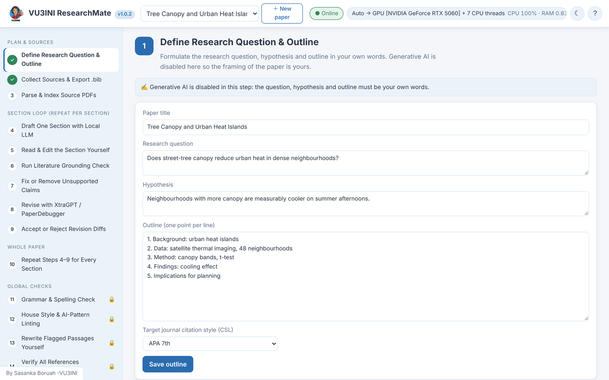
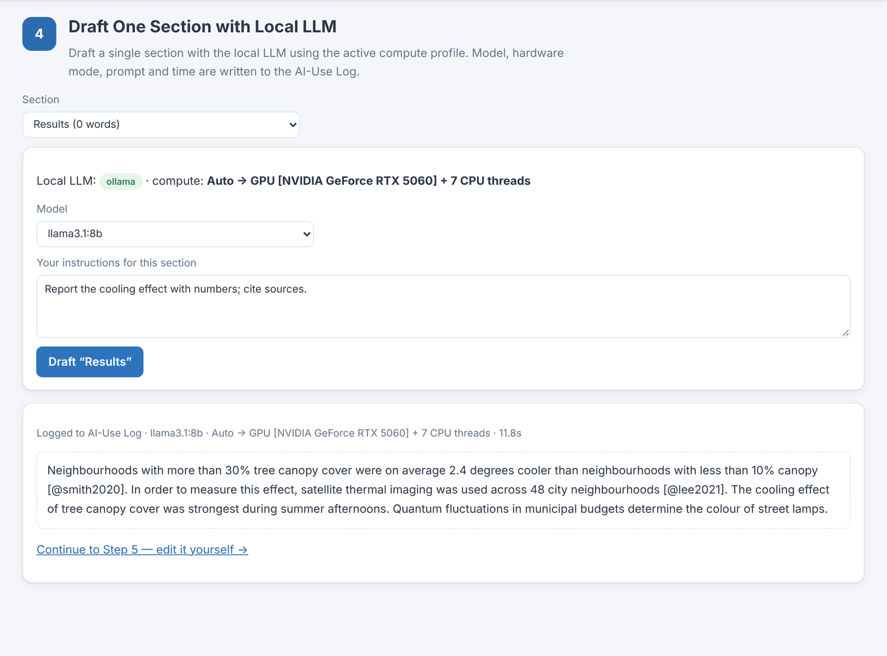
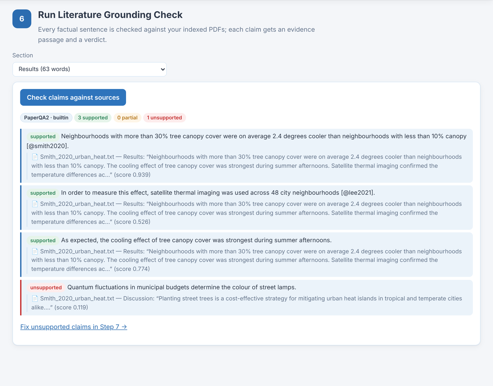
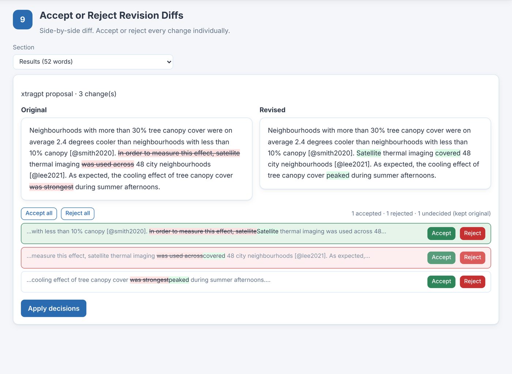
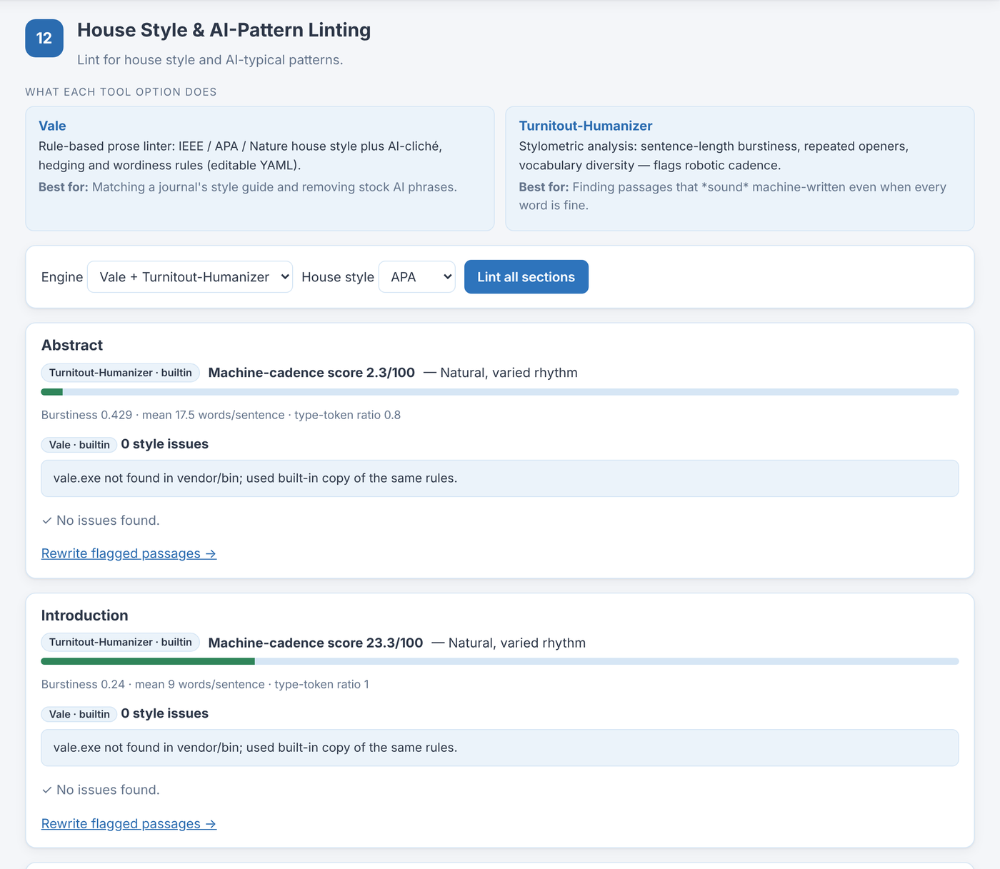
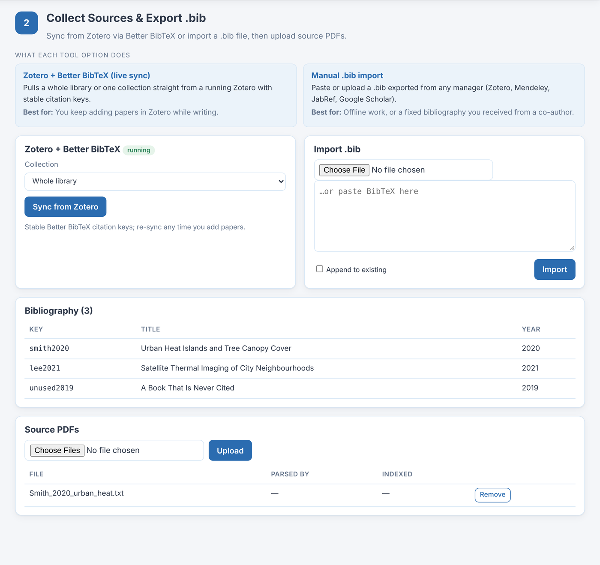
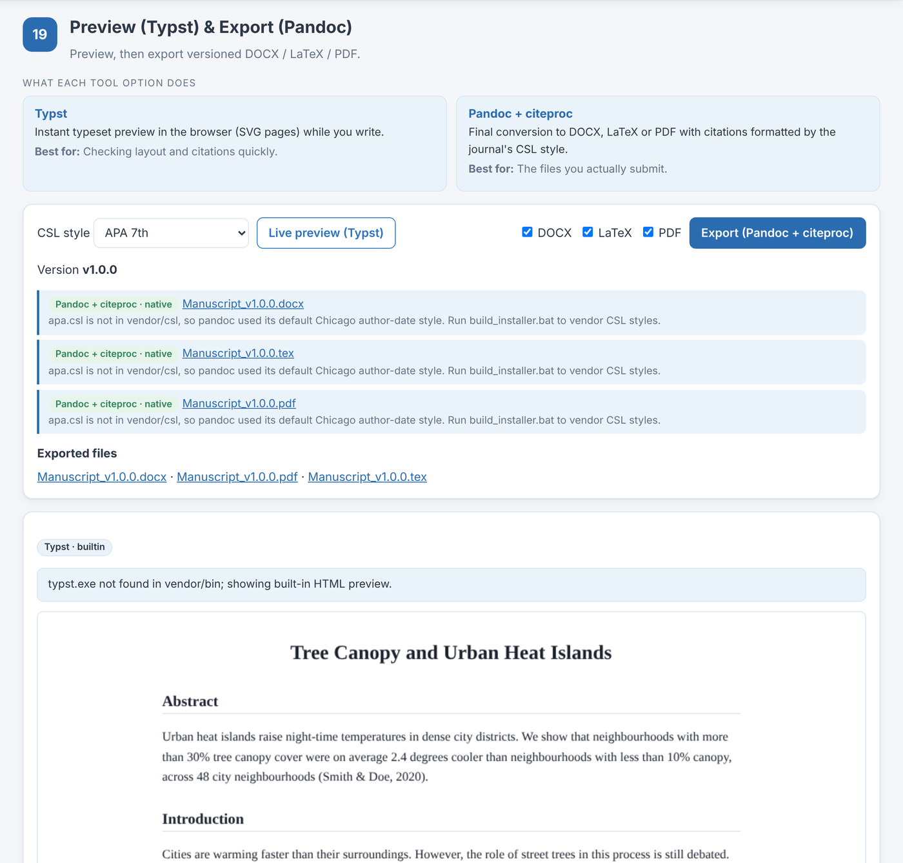
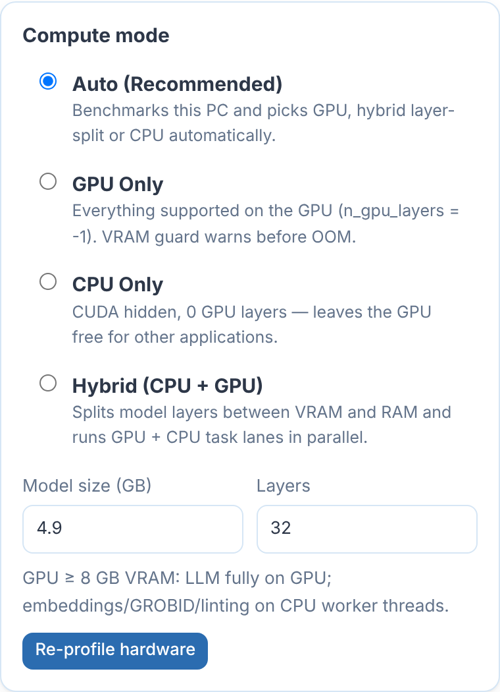

<p align="center">
  
</p>

<h1 align="center">VU3INI ResearchMate</h1>

<p align="center">
  <b>Write your research paper section by section — then verify every claim, reference and number before you submit.</b><br>
  A private, offline-first research-paper workbench for Windows 10 / 11 that runs in your own web browser.
</p>

<p align="center">
  
  
  
  
</p>

<p align="center">
  <a href="docs/VU3INI_ResearchMate_User_Manual_v1.0.2.pdf"><b>User manual (PDF)</b></a> ·
  <a href="../../releases"><b>Download</b></a> ·
  <a href="#the-21-step-workflow">The 21 steps</a> ·
  <a href="#building-from-source">Build from source</a>
</p>



---

## Why ResearchMate?

Language models can draft a paper in minutes, and that is exactly the problem: drafts arrive full of claims
nobody checked, references that may not exist, numbers that drift between the Abstract and the Results, and
phrasing that reads as machine-written. Journals now ask authors to disclose how AI was used.

ResearchMate is built around a simple rule: **the AI may propose, but the author decides and everything gets
verified.**

- **You frame the paper.** The research question, hypothesis and outline are written by you — generative AI is
  switched off in Step 1.
- **AI output is only ever a proposal.** Drafts are edited by you, and every revision is shown as a diff in which
  each change is accepted or rejected individually.
- **Every claim is checked against your own sources.** Sentences are matched to passages in the PDFs you supplied,
  with the evidence quoted.
- **Every reference is checked against the scholarly record** (Crossref, OpenAlex, Semantic Scholar, arXiv) to catch
  wrong or hallucinated citations.
- **AI use is logged and disclosed.** Model, hardware, prompt, time and word count are recorded for every AI call and
  turned into a journal-ready AI-Use Disclosure Statement.
- **Nothing leaves your PC.** The language model, the checkers and your manuscript all stay local. Only reference
  verification and first-time downloads use the internet.

## Highlights

| | |
|---|---|
| **Runs in your browser** | A small local server; the interface opens in Edge, Chrome, Firefox or Brave at `http://127.0.0.1:8765`. No Electron, no desktop shell, no CDN. |
| **Offline installer** | The release bundle contains Python, every package and ready-to-run tools. `install_offline.bat` needs no internet. |
| **Local AI, your GPU** | Ollama manages the model (default `llama3.1:8b`); drafting runs on NVIDIA GPUs through a bundled llama.cpp CUDA 12.9 engine. |
| **Four compute modes** | Auto, GPU Only, CPU Only and Hybrid (layers split between VRAM and RAM, GPU and CPU work running side by side). |
| **Self-provisioning** | Step 2 installs and starts Zotero with Better BibTeX; Step 4 starts Ollama and pulls the model — each with a live progress card. |
| **15 research tools in one flow** | Harper, LanguageTool, Vale, Turnitout-Humanizer, XtraGPT, PaperDebugger, GROBID, PaperQA2, RefChecker, CiteScan, check-citations, Paper Analysis Utility, Zotero + Better BibTeX, Typst, Pandoc + citeproc. |
| **Journal-ready output** | DOCX, LaTeX and PDF in APA, IEEE, Vancouver, Chicago, Nature or ACM style, plus a submission bundle. |
| **Light and dark themes** | Remembered per user. |

## The 21-step workflow

The left column of the app is a guided pipeline. Steps 4–9 are a loop you repeat for every section; Steps 11–21
check and finish the whole paper and unlock only when every written section has been edited, grounded and reviewed.

| # | Step | What it does | Tools |
|---:|---|---|---|
| 1 | Define Research Question & Outline | Question, hypothesis, outline and target citation style — in your own words | AI disabled |
| 2 | Collect Sources & Export .bib | Live Zotero sync or `.bib` import; upload source PDFs | Zotero + Better BibTeX |
| 3 | Parse & Index Source PDFs | Split sources into sections and index passages | GROBID, PaperQA2 |
| 4 | Draft One Section with Local LLM | Draft a single section; logged to the AI-Use Log | Ollama / llama.cpp |
| 5 | Read & Edit the Section Yourself | Human-in-the-loop editing with a human-edit ratio | Editor |
| 6 | Run Literature Grounding Check | Each claim → supported / partial / unsupported, with evidence | PaperQA2 |
| 7 | Fix or Remove Unsupported Claims | Guided queue: revise, cite or delete | Claim queue |
| 8 | Revise with XtraGPT / PaperDebugger | Polish (XtraGPT) or reviewer-style critique (PaperDebugger) | XtraGPT, PaperDebugger |
| 9 | Accept or Reject Revision Diffs | Side-by-side diff; decide on every change | Diff viewer |
| 10 | Repeat Steps 4–9 for Every Section | Completion matrix; unlocks the global checks | Matrix |
| 11 | Grammar & Spelling Check | Instant or deep grammar checking | Harper, LanguageTool |
| 12 | House Style & AI-Pattern Linting | IEEE / APA / Nature rules, AI clichés, machine-cadence score | Vale, Turnitout-Humanizer |
| 13 | Rewrite Flagged Passages Yourself | Workbench with live readability and burstiness | Workbench |
| 14 | Verify All References | Title, authors, year and DOI against four databases | RefChecker |
| 15 | Match Citations & Clean .bib | 1-to-1 citation ↔ `.bib` parity; static `.bib` validation | CiteScan, check-citations |
| 16 | Source Overlap Check | Verbatim and close-paraphrase detection against your sources | Overlap detector |
| 17 | Cross-Section Consistency | Abstract vs Results numbers, acronyms, figure and table references | Paper Analysis Utility |
| 18 | Generate AI-Use Disclosure | Journal-ready statement from the audit log | Audit log |
| 19 | Preview & Export | Typeset preview; versioned DOCX / LaTeX / PDF in any CSL style | Typst, Pandoc + citeproc |
| 20 | Final Read-Through | Distraction-free reader with a pre-submission checklist | Reader |
| 21 | Submit | `Submission_Bundle_vX.Y.Z.zip` with manuscript, cleaned `.bib`, figures and disclosure | Bundle |

Every step that offers a choice of tools shows a **“What each tool option does”** card explaining the difference.

### A closer look

<table>
<tr>
<td width="50%"><br>
<sub><b>Step 4</b> — drafting one section on the local GPU; every call goes into the AI-Use Log.</sub></td>
<td width="50%"><br>
<sub><b>Step 6</b> — every claim checked against your sources, with the evidence passage quoted.</sub></td>
</tr>
<tr>
<td><br>
<sub><b>Step 9</b> — accept or reject each proposed change individually.</sub></td>
<td><br>
<sub><b>Step 12</b> — house style, AI-cliché phrasing and a machine-cadence score per section.</sub></td>
</tr>
<tr>
<td><br>
<sub><b>Step 2</b> — Zotero + Better BibTeX started automatically; pick a collection and sync.</sub></td>
<td><br>
<sub><b>Step 19</b> — typeset preview and versioned exports in the journal's citation style.</sub></td>
</tr>
</table>

## Compute modes



A hardware profiler detects the CPU (cores, AVX2/AVX-512), RAM and every GPU (NVIDIA via `nvidia-smi`, others via
Windows), then a scheduler builds one compute plan used by every component:

- **Auto** *(default)* — GPU with ≥ 8 GB and a model that fits: the LLM runs fully on the GPU while PDF parsing,
  indexing and linting run on CPU worker threads. Limited VRAM or mismatched GPUs: hybrid layer split. No discrete
  GPU: multi-threaded CPU (physical cores − 1).
- **GPU Only** — all supported work on the GPU, with a VRAM guard warning before out-of-memory.
- **CPU Only** — the GPU is hidden and left free for other applications.
- **Hybrid** — model layers split between VRAM and RAM (auto-calculated or set with a slider), and a GPU lane
  (drafting, revision) runs in parallel with CPU workers (indexing, grammar, style, reference checks).

A live pill in the header shows the active plan with CPU, RAM and GPU usage, and switching takes effect
immediately. CUDA out-of-memory errors are caught: GPU layers are halved and the request retried automatically.

<br clear="right">

## Installation

**Requirements:** Windows 10 or 11 (64-bit), 8 GB RAM (16 GB recommended), about 4 GB of disk for the app plus
about 5 GB for the default model. An NVIDIA GPU is optional; with one, a recent driver (CUDA 12.9 capable) is needed.

1. Download all four parts of the latest release from the **[Releases](../../releases)** page
   (`VU3INI_ResearchMate_v1.0.2_part1of4.zip` … `part4of4.zip`).
2. Extract them to the same folder, for example `D:\ResearchMate`. They merge into one `VU3INI-ResearchMate` folder.
   (If Windows extracts each part into its own folder, the installer finds and merges them.)
3. Run **`install_offline.bat`** once. It verifies the parts, installs everything without internet, then starts
   Ollama and downloads `llama3.1:8b` (once, needs internet; Step 4 retries later if you are offline).
4. Run **`run_ResearchMate.bat`**. Your default browser opens the app.

The [user manual](docs/VU3INI_ResearchMate_User_Manual_v1.0.2.pdf) walks through installation and every step with
screenshots.

## Architecture

```
Browser (Edge / Chrome / Firefox / Brave)
   │  plain HTML + CSS + ES modules, no framework, no CDN
   ▼
FastAPI + Uvicorn on 127.0.0.1:8765 ──── SQLite (projects, sections, sources, AI log, revisions)
   │
   ├── Hardware manager ── profile → compute plan → GPU lane + CPU worker pool, OOM fallback
   │
   └── Tool adapters ───── each reports "native" (bundled tool ran) or "builtin" (offline fallback)
         grammar & style   Harper · LanguageTool · Vale · Turnitout-Humanizer
         drafting          Ollama · llama.cpp CUDA (llama-server on Ollama's own model file)
         revision          XtraGPT · PaperDebugger
         sources           GROBID · PaperQA2 · Zotero + Better BibTeX
         verification      RefChecker · CiteScan · check-citations · Paper Analysis Utility · overlap
         output            Typst · Pandoc + citeproc · AI-use disclosure · submission bundle
```

**Native tools and built-in engines.** Every check has an offline fallback, so the app never stops at a missing
service. Results are labelled so you always know which engine ran:

| Tool | Native when | Built-in fallback |
|---|---|---|
| Harper | `harper-cli.exe` bundled | fast grammar / spelling rules |
| LanguageTool | Java runtime + LanguageTool server | deep contextual rules |
| Vale | `vale.exe` bundled (uses ResearchMate's own YAML styles) | same rules in Python |
| Turnitout-Humanizer | torch + perplexity model present | burstiness, sentence-opener and vocabulary stylometrics |
| XtraGPT / PaperDebugger | local LLM running | rule-based concision and structural critique |
| GROBID | GROBID service on port 8070 | PyMuPDF / pypdf section parser |
| PaperQA2 | embedding model present (dense retrieval) | BM25 passage retrieval |
| RefChecker | internet available | references marked *unverified-offline* |
| Typst | `typst.exe` bundled | HTML preview with built-in citation formatting |
| Pandoc + citeproc | `pandoc.exe` bundled | built-in DOCX / LaTeX writer, PyMuPDF PDF |

CiteScan, check-citations and the Paper Analysis Utility are implemented inside ResearchMate.

## Building from source

The repository holds the source only; tools and packages are downloaded into `vendor/` by the build script.

```bat
git clone https://github.com/hamvu3ini/VU3INI-ResearchMate.git
cd VU3INI-ResearchMate
build_installer.bat                  REM tests → live browser check → vendor deps → dist\VU3INI_ResearchMate_vX.Y.Z.zip
build_installer.bat --auto-confirm   REM unattended build (no Y/N prompt)
build_installer.bat --skip-ml        REM smaller bundle without GPU engine and ML models
build_installer.bat --max-part-mb 380  REM also split the ZIP into download-sized parts
```

The build is gated in three stages: **(1)** the pytest suite must pass; **(2)** the real server is started, opened in
the default browser and checked end to end, then waits for your **[Y]/[N]**; **(3)** dependencies are vendored —
Windows wheels (including Windows-only dependencies), a portable Python and the Windows tools from conda-forge via
micromamba, CSL styles, models and installers — and a versioned ZIP is written, bumping the patch version if that
version already exists. `vendor/BUNDLE_REPORT.txt` records what was and was not bundled.

**Run from source for development** (any OS with Python 3.10+):

```bash
pip install -r requirements.txt
python run.py                 # opens the browser
python -m pytest tests -v     # 48 offline tests: adapters, compute modes, all 21 steps, exports, branding
```

## Project layout

```
backend/        FastAPI server, SQLite database, hardware manager, workflow, 16 tool adapters
frontend/       index.html, styles.css, app.js, assets (logo, favicon, fallback SVG)
tests/          end-to-end and unit tests + fixtures (sample .bib files, hardware profiles, source text)
scripts/        build_offline_bundle.py, verify_before_zip.py, setup_llm.py, make_logo.py, vendor_manifest.json
docs/           user manual (PDF) and screenshots
*.bat           install_offline.bat, run_ResearchMate.bat, build_installer.bat
```

## Limitations

- The language model weights are not in the release; `llama3.1:8b` is downloaded once by Ollama.
- LanguageTool and GROBID are Java services and are not bundled; their built-in fallbacks are used unless you run them.
- No public repositories were found for Turnitout-Humanizer, PaperDebugger, Paper Analysis Utility or check-citations,
  so these are ResearchMate's own implementations of the described checks.
- Grounding and overlap checks can only see the sources you upload; “unsupported” means “no evidence in your sources”.
- Automatic Zotero and Ollama setup are Windows-only; on other systems install them yourself.

## Acknowledgements

ResearchMate orchestrates excellent open-source projects, each under its own licence:
[Harper](https://github.com/Automattic/harper) ·
[LanguageTool](https://github.com/languagetool-org/languagetool) ·
[Vale](https://github.com/errata-ai/vale) ·
[XtraGPT](https://github.com/nuojohnchen/XtraGPT) ·
[GROBID](https://github.com/kermitt2/grobid) ·
[PaperQA2](https://github.com/Future-House/paper-qa) ·
[RefChecker](https://github.com/markrussinovich/refchecker) ·
[CiteScan](https://github.com/aivolcano/CiteScan) ·
[Zotero](https://www.zotero.org) ·
[Better BibTeX](https://github.com/retorquere/zotero-better-bibtex) ·
[Ollama](https://github.com/ollama/ollama) ·
[llama.cpp](https://github.com/ggml-org/llama.cpp) ·
[Typst](https://github.com/typst/typst) ·
[Pandoc](https://github.com/jgm/pandoc) ·
[Citation Style Language](https://github.com/citation-style-language/styles) ·
[conda-forge](https://conda-forge.org).
Scholarly metadata comes from Crossref, OpenAlex, Semantic Scholar and arXiv.

## Author

**Sasanka Boruah — VU3INI** · hamvu3ini@gmail.com

<sub>By Sasanka Boruah -VU3INI</sub>
